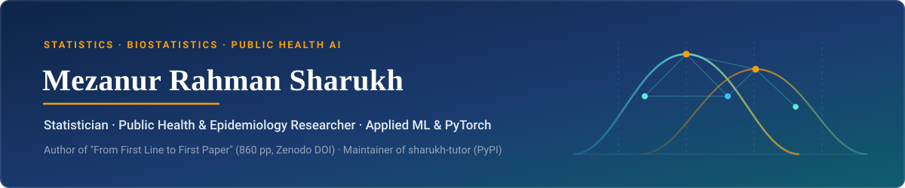

  

  
  
  
  
  
  

I am a **Statistician and Public Health & Applied Machine Learning Researcher** working across complex population health surveys, environmental epidemiology, climate-sensitive infectious disease modelling, and responsible clinical AI.

---

### Flagship Open-Access Textbook & PyPI Package

<table>
  <tr>
    <td width="175" align="center" valign="top">
      
    </td>
    <td valign="top">
      <strong><a href="https://github.com/sharukh01621/first-line-to-first-paper">From First Line to First Paper: Mastering Python, Statistical Data Science, and Applied Deep Learning</a></strong> 
      <em>First Edition (2026) · 860 Pages · 36 Chapters + 5 Appendices · 100% Free &amp; Open Access</em>  
      <ul>
        <li><strong>End-to-End Curriculum:</strong> Zero-prerequisite Python &rarr; Pandas 3.x survey wrangling &rarr; Biostatistics &rarr; Leakage-free Scikit-Learn &rarr; PyTorch (MLPs, CNNs, GRUs/LSTMs, Transformers, LoRA) &rarr; Ablations, Subgroup Fairness, Decision Curve Analysis &amp; TRIPOD+AI.</li>
        <li><strong>182 Interactive Google Colab Notebooks:</strong> Paired 1-to-1 with every chapter (Walkthroughs, Guided To-Dos, 100-Point Coding Exams &amp; Annotated Solutions).</li>
        <li><strong>Published on PyPI (<code>pip install sharukh-tutor</code>):</strong> 324 automated diagnostic checks, 972 three-tier progressive hints, and 3 realistic public health spine datasets.</li>
      </ul>
      <a href="https://sharukh01621.github.io/first-line-to-first-paper/">Read Web Book</a> &nbsp;&middot;&nbsp;
      <a href="https://github.com/sharukh01621/first-line-to-first-paper/releases/download/v1.0.2/From-First-Line-to-First-Paper.pdf">Download PDF</a> &nbsp;&middot;&nbsp;
      <a href="https://github.com/sharukh01621/first-line-to-first-paper/releases/download/v1.0.2/From-First-Line-to-First-Paper.epub">Download EPUB 3</a> &nbsp;&middot;&nbsp;
       &nbsp;&middot;&nbsp;
      <a href="https://pypi.org/project/sharukh-tutor/">PyPI Package</a>
    </td>
  </tr>
</table>

---

### Ongoing Research Themes

| Area | High-Level Methodological Scope |
| :--- | :--- |
| **Environmental Epidemiology & Child Development** | Investigating environmental exposures and early childhood developmental outcomes in national household surveys using survey-weighted Bayesian modelling and interpretable ML |
| **Maternal & Child Health Equity** | Analysing socioeconomic disparities, maternal healthcare utilization, and child nutrition across multi-round demographic surveys via multilevel models and inequality decomposition |
| **Climate-Sensitive Infectious Disease Modelling** | Studying meteorological drivers and seasonal dynamics of vector-borne diseases with statistical time-series forecasting, ensemble trees, and deep sequence architectures |
| **Fairness-Aware & Calibrated Clinical AI** | Building probability-calibrated, equity-audited ML workflows for chronic disease quality-of-life and mental health risk assessment aligned with transparent clinical reporting |
| **Field Epidemiology & Open Educational Tooling** | Digital survey operations (KoboToolbox / ODK) for antimicrobial resistance studies alongside open-source Python packages for statistical education |

---

### Technical Stack

| Area | Core Tools & Methods |
| :--- | :--- |
| **Python, R & Data Science** | `Python` (`NumPy`, `Pandas`, `SciPy`, `Statsmodels`, `Scikit-Learn`, `PyTorch`, `Matplotlib`, `Seaborn`), `R`, `SQL`, `SPSS`, `Google Colab`, `Jupyter` |
| **Biostatistics & Epidemiology** | Complex Survey Analysis, Bayesian & Multilevel Modelling, GLM/Ordinal Regression, `ARIMA`, Concentration Indices, Inequality Decomposition, Decision Curve Analysis |
| **ML, Deep Learning & Responsible AI** | `XGBoost`, `LightGBM`, `Random Forest`, `PyTorch` (`MLPs`, `CNNs`, `GRUs`, `LSTMs`, `Transformers`, `LoRA`), Nested CV, Calibration, Fairness Audits, `SHAP`, `TRIPOD+AI` |
| **Engineering & Field Data** | `Git`, `GitHub`, `PyPI Packaging`, `pytest`, `Quarto`, `LaTeX`, `KoboToolbox`, `ODK`, Reproducible Research Pipelines |

---

### Contact & Collaboration

- **Portfolio:** [sharukh01621.github.io](https://sharukh01621.github.io/) · **Email:** `shahrukh01621@gmail.com` · **ORCID:** [0009-0006-8348-6123](https://orcid.org/0009-0006-8348-6123)
- Royal Statistical Society e-Student Member · Open to Public Health Research, Biostatistics, Applied ML & Academic Collaborations (CV available upon request).
