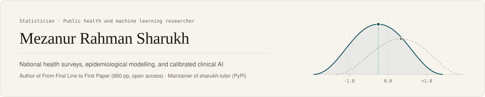

  <a href="https://sharukh01621.github.io/">
    <picture>
      <source media="(prefers-color-scheme: dark)" srcset="assets/banner-dark.svg" />
      <source media="(prefers-color-scheme: light)" srcset="assets/banner-light.svg" />
      
    </picture>
  </a>

  <a href="https://sharukh01621.github.io/">Portfolio</a> &nbsp;&middot;&nbsp;
  <a href="https://sharukh01621.github.io/first-line-to-first-paper/">Web book</a> &nbsp;&middot;&nbsp;
  <a href="https://doi.org/10.5281/zenodo.24446563">Zenodo DOI</a> &nbsp;&middot;&nbsp;
  <a href="https://pypi.org/project/sharukh-tutor/">PyPI</a> &nbsp;&middot;&nbsp;
  <a href="https://orcid.org/0009-0006-8348-6123">ORCID</a> &nbsp;&middot;&nbsp;
  <a href="https://www.linkedin.com/in/mezanur-rahman-sharukh-16281a22b">LinkedIn</a> &nbsp;&middot;&nbsp;
  <a href="mailto:shahrukh01621@gmail.com">Email</a>

My work connects classical statistical methodology with reproducible machine learning across environmental exposure assessment, maternal and child health, climate-sensitive infectious diseases, and calibrated clinical prediction. I also maintain open educational tools for quantitative health researchers.

---

### `01` &nbsp; Open-access book and software

<table>
  <tr>
    <td width="176" align="center" valign="top">
      
    </td>
    <td valign="top">
      

        <strong><a href="https://github.com/sharukh01621/first-line-to-first-paper">From First Line to First Paper</a></strong> 
        Mastering Python, Statistical Data Science, and Applied Deep Learning
      

      

        A self-contained, free textbook written for students, statisticians, and quantitative health researchers. It moves step by step from first Python statements and survey data wrangling to biostatistics, leakage-free Scikit-Learn pipelines, PyTorch architectures (MLPs, CNNs, GRUs, LSTMs, Transformers, LoRA), ablation studies, subgroup fairness audits, Decision Curve Analysis, and TRIPOD+AI reporting.
      

      

        <code>860 pages</code> &nbsp;&middot;&nbsp;
        <code>182 Colab labs</code> &nbsp;&middot;&nbsp;
        <code>324 auto checks</code> &nbsp;&middot;&nbsp;
        <code>972 guided hints</code>
      

      

        Install the companion verifier package: <code>pip install sharukh-tutor</code>
      

      

        <a href="https://sharukh01621.github.io/first-line-to-first-paper/">Read web book</a> &nbsp;&middot;&nbsp;
        <a href="https://github.com/sharukh01621/first-line-to-first-paper/releases/download/v1.0.2/From-First-Line-to-First-Paper.pdf">PDF (12.5 MB)</a> &nbsp;&middot;&nbsp;
        <a href="https://github.com/sharukh01621/first-line-to-first-paper/releases/download/v1.0.2/From-First-Line-to-First-Paper.epub">EPUB 3</a> &nbsp;&middot;&nbsp;
         &nbsp;&middot;&nbsp;
        <a href="https://drive.google.com/drive/folders/1pHBCVND-bRsPV4FarRPqOmivYkVmRFBF?usp=drive_link">Google Drive</a> &nbsp;&middot;&nbsp;
        <a href="https://pypi.org/project/sharukh-tutor/">PyPI</a>
      

    </td>
  </tr>
</table>

---

### `02` &nbsp; Ongoing research

External overview of active research areas

| Domain | Scope |
| :--- | :--- |
| Environmental epidemiology | Investigating environmental exposure indicators and early childhood developmental outcomes in nationally representative household surveys through survey-weighted Bayesian modelling and interpretable machine learning |
| Maternal and child health | Examining socioeconomic disparities, maternal healthcare utilization, birth spacing, and child growth patterns across multi-round demographic surveys using multilevel modelling and inequality decomposition |
| Infectious disease modelling | Studying relationships between meteorological variability and infectious disease surveillance dynamics via lagged climate features, statistical time-series forecasting, ensemble trees, and deep sequence architectures |
| Responsible clinical AI | Designing probability-calibrated, subgroup-audited machine learning workflows for chronic disease quality-of-life and mental health risk assessment aligned with transparent clinical reporting standards |
| Field epidemiology | Building quantitative survey instruments, KoboToolbox and ODK field data workflows, and mixed-methods analytical pipelines for antimicrobial resistance awareness, oral health, and population studies |
| Open statistical education | Developing open-source Python packages, automated diagnostic verification engines, and self-contained cloud labs so quantitative health learners can practice reproducible ML without local setup barriers |

---

### `03` &nbsp; Methods and computational stack

| Area | Tools and methods |
| :--- | :--- |
| Python, R, and scientific computing | Python (NumPy, Pandas, SciPy, Statsmodels, Scikit-Learn, PyTorch, Matplotlib, Seaborn, Joblib), R, SQL, SPSS, Google Colab, Jupyter |
| Biostatistics and survey methodology | Complex survey analysis, survey-weighted estimation, Bayesian and multilevel modelling, generalized linear and ordinal regression, ARIMA, concentration indices, inequality decomposition, Decision Curve Analysis |
| Machine learning and responsible AI | Random Forest, XGBoost, LightGBM, SVM, PyTorch (MLPs, CNNs, GRUs, LSTMs, Transformers, LoRA), leakage-free pipelines, nested cross-validation, probability calibration, subgroup fairness auditing, SHAP, TRIPOD+AI |
| Engineering and field workflows | Git, GitHub, PyPI packaging, pytest, Quarto, LaTeX, KoboToolbox, ODK |

---

### `04` &nbsp; Contact

Bangladesh · Royal Statistical Society e-Student member · Open to public health research, biostatistics, applied ML, and academic collaborations.

`shahrukh01621@gmail.com` · [sharukh01621.github.io](https://sharukh01621.github.io/) · [ORCID 0009-0006-8348-6123](https://orcid.org/0009-0006-8348-6123) · Full CV available upon request
